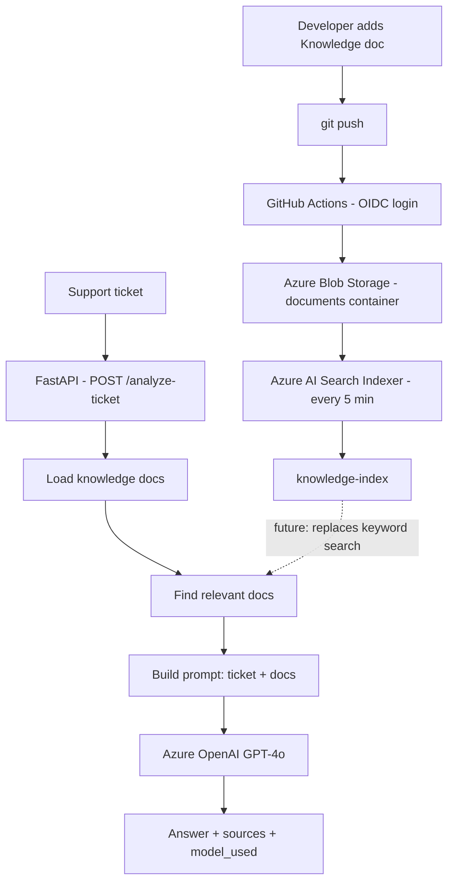

# Enterprise AI Ticket Intelligence Platform on Azure

**Project documentation: overview, architecture, technology stack and learnings**

Author: Aryan Dadheech

---

## 1. Executive Summary

The Enterprise AI Ticket Intelligence Platform is an AI-powered system that analyzes IT support tickets and returns grounded, actionable resolutions. It uses **Retrieval-Augmented Generation (RAG)**. Instead of letting the language model answer from its general training data, the platform first retrieves relevant internal runbooks and incident reports. It then asks **Azure OpenAI GPT-4o** to answer using only that material, and it cites the source documents.

The entire Azure infrastructure is provisioned with **Terraform (Infrastructure as Code)**. Knowledge documents flow automatically from Git to Azure through **GitHub Actions authenticated with OIDC**, so no secrets are stored anywhere.

### Problem Statement
Support engineers lose time searching scattered runbooks and past incidents for every new ticket. Answers are inconsistent, and tribal knowledge is hard to reuse.

### Solution
A REST API that accepts a ticket description, finds the relevant knowledge documents, and returns an answer, a list of source documents (citations), and the model used.

### Key Outcomes
- A working FastAPI service exposing `POST /analyze-ticket`, tested locally with Swagger UI.
- A complete, reproducible Azure environment defined in code (7 Terraform modules).
- A secretless CI/CD pipeline that publishes knowledge documents to Azure Blob Storage.
- A configured Azure AI Search pipeline (data source, index and indexer) for the semantic search upgrade path.
- Cost-aware operation: expensive resources are destroyed when idle and rebuilt in about 5 minutes.

---

## 2. Architecture

### 2.1 High-level flow



### 2.2 Two pipelines

1. **Knowledge ingestion pipeline (developer workflow)**
   A new or updated `.md` file in `Knowledge/` is pushed to GitHub. GitHub Actions logs in to Azure using OIDC and uploads the file to Blob Storage. The Azure AI Search indexer runs every 5 minutes and keeps `knowledge-index` up to date.

2. **Ticket analysis pipeline (runtime workflow)**
   A client calls `POST /analyze-ticket`. The API loads the knowledge documents and selects the relevant ones. It builds a prompt with the ticket and those documents, calls GPT-4o, and returns the answer with citations.

---

## 3. Technology Stack

| Layer | Technology | Why it was used |
|---|---|---|
| Cloud platform | Microsoft Azure | Enterprise-grade hosting, identity and AI services |
| Infrastructure as Code | Terraform | Reproducible, version-controlled infrastructure |
| LLM | Azure OpenAI (GPT-4o) | Generates grounded answers from retrieved context |
| Embeddings | text-embedding-3-small | Vector representation of documents for semantic search |
| AI Foundry | Azure AI Foundry project | Model management and deployment |
| Search | Azure AI Search (Standard SKU) | Indexing, vector and semantic search |
| Storage | Azure Blob Storage | Central store for knowledge documents |
| Secrets | Azure Key Vault | Centralized secret management |
| Monitoring | Application Insights + Log Analytics | Tracing, metrics and centralized logs |
| Backend | Python, FastAPI, Uvicorn | High-performance REST API with automatic Swagger docs |
| Validation | Pydantic | Request and response schema validation |
| AI SDK | `openai` Python SDK (`AzureOpenAI`) | Client for Azure OpenAI |
| CI/CD | GitHub Actions | Automated ingestion and AI Search setup |
| Authentication | OIDC (Workload Identity Federation), Managed Identity, `DefaultAzureCredential` | Secretless access to Azure |
| Authorization | Azure RBAC | Least-privilege role assignments |

---

## 4. Azure Infrastructure

All resources live in one resource group and are created by Terraform modules.

| Resource | Name | Purpose |
|---|---|---|
| Resource Group | `rg-ai-ticket-dev` | Container for all resources |
| Storage Account | `aiticketstorage99` | Hosts the `documents` blob container |
| Key Vault | `kv-aiticket99` | Secrets management |
| Azure OpenAI | `aoai-arya001` | GPT-4o and text-embedding-3-small deployments |
| AI Search | `aisearch-aiticket-v2` | Vector and semantic search (SystemAssigned identity, RBAC on Storage) |
| Application Insights | `appi-aiticket-dev` | Monitoring and tracing |
| Log Analytics Workspace | `law-aiticket-dev` | Centralized logs |

### Terraform module layout

```
modules/
  resource_group/
  storage_account/
  key_vault/
  Azure_openai/
  ai_search/
  log_analytics_workspace/
  application_insights/
```

Each module has its own `main.tf`, `variables.tf` and `outputs.tf`. The root `main.tf` wires the modules together. `variables.tf` and `terraform.tfvars` hold the inputs, and `output.tf` exposes values after `terraform apply`.

---

## 5. Application Design (FastAPI RAG Service)

### 5.1 Files

| File | Responsibility |
|---|---|
| `app/main.py` | FastAPI app and endpoints |
| `app/rag.py` | RAG pipeline (load, search, GPT) |
| `app/models.py` | Pydantic request and response schemas |
| `app/config.py` | Settings loaded from environment variables |
| `app/requirements.txt` | Python dependencies |

### 5.2 API endpoints

| Method | Endpoint | Description |
|---|---|---|
| GET | `/` | Welcome message |
| GET | `/health` | Health check, returns `{"status": "ok"}` |
| POST | `/analyze-ticket` | Analyze a ticket using RAG |
| GET | `/docs` | Interactive Swagger UI |

**Request**
```json
{ "ticket": "Logic App is giving 401 unauthorized error in production" }
```

**Response**
```json
{
  "answer": "Based on logic-app-authentication-runbook.md, the 401 error is caused by an expired managed identity token. Steps to resolve: ...",
  "sources": [
    "logic-app-authentication-runbook.md",
    "previous-incident-logic-app-401.md"
  ],
  "model_used": "gpt-4o"
}
```

### 5.3 RAG pipeline (`app/rag.py`)

| Step | Function | What it does |
|---|---|---|
| 1. Load | `load_knowledge_docs()` | Reads all `.md` files from `Knowledge/` into a dict of filename to content. |
| 2. Retrieve | `find_relevant_docs()` | Extracts keywords longer than 3 characters from the ticket. A document is relevant if at least 2 keywords appear in its name or content. If nothing matches, all documents are used as a fallback. |
| 3. Generate | `ask_gpt()` | Builds a system prompt and a user prompt (ticket + labelled documents) and calls GPT-4o with `temperature=0.3` and `max_tokens=800`. |
| 4. Orchestrate | `analyze_ticket()` | Runs steps 1 to 3 and returns `answer`, `sources` and `model_used`. |

**Prompt engineering decisions**
- The system prompt fixes the role ("expert IT support engineer") and the rules.
- The model must answer **only from the provided documents**, which reduces hallucination.
- The model must say so when the documents don't cover the issue.
- It must mention which document the answer is based on, so the answer can be traced to a source.
- A low temperature (0.3) keeps the answers consistent and factual.

**Mock mode**
`MOCK_MODE=true` returns a clearly labelled placeholder response without calling Azure. This allows full local development and testing with no Azure credits. Setting `MOCK_MODE=false` and providing a valid `AZURE_OPENAI_KEY` switches to real GPT-4o calls.

**Designed for upgrade**
`find_relevant_docs()` has a stable interface (ticket + docs in, relevant docs out). It can be replaced with Azure AI Search vector or semantic retrieval without changing any other code.

---

## 6. Knowledge Base

The `Knowledge/` folder is the enterprise knowledge the model is allowed to use:

| Document | Content |
|---|---|
| `logic-app-authentication-runbook.md` | Fixing Logic App authentication problems |
| `database-connection-runbook.md` | Database connectivity troubleshooting |
| `api-integration-troubleshooting.md` | API integration failures |
| `incident-priority-guide.md` | How to classify incident priority |
| `previous-incident-logic-app-401.md` | A past incident report for a Logic App 401 error |

Adding a document is a normal Git workflow: add a `.md` file, push, and the pipeline uploads it.

---

## 7. CI/CD and Automation

| Pipeline | Trigger | Action |
|---|---|---|
| `ingest-knowledge.yml` | Push to `Knowledge/` | Uploads the `.md` files to Blob Storage |
| `setup-ai-search.yml` | Manual | Creates the AI Search data source, index and indexer |

| Script | Purpose |
|---|---|
| `scripts/ingest_documents.py` | Uploads the knowledge docs to Blob Storage using `DefaultAzureCredential` |
| `scripts/setup_ai_search.py` | Calls the AI Search REST API to create the data source, index and indexer |

**AI Search objects created**
- Data source: `blob-documents`, pointing at the storage container.
- Index: `knowledge-index`, with the fields `id`, `content` and `metadata`.
- Indexer: `blob-indexer`, which runs every 5 minutes (`PT5M`) and was triggered immediately on creation.

Both pipelines ran successfully. The ingestion pipeline took about 27 seconds and the AI Search setup about 1 minute 9 seconds.

---

## 8. Security Design

| Principle | Implementation |
|---|---|
| No secrets in code | All keys come from environment variables. `.env` files are git-ignored. |
| Secretless CI/CD | GitHub Actions uses OIDC Workload Identity Federation, so it gets short-lived tokens and stores no Azure credentials. |
| Managed Identity | AI Search reads Blob Storage with its system-assigned identity, with no storage keys. |
| Least privilege | Azure RBAC role assignments scoped to what each component needs. |
| Central secrets | Key Vault is provisioned for production secrets. |
| Repository hygiene | `.gitignore` excludes `.env`, `.terraform/`, `*.tfstate*`, `__pycache__/` and `.vscode/`. |

---

## 9. Cost Management

| Resource | Cost behaviour | Strategy |
|---|---|---|
| Azure AI Search (Standard) | High (about Rs. 18,000/month) | Destroyed after setup and rebuilt in about 5 minutes with `terraform apply` |
| Azure OpenAI | Pay per use | No cost when idle |
| Storage and Key Vault | Under Rs. 1/month | Kept running |
| Application Insights | Free tier | Kept running |

Infrastructure as Code is what makes this strategy possible. Costly services can be torn down and recreated reliably.

---

## 10. How to Run Locally

```bash
# 1. Install dependencies
pip install -r app/requirements.txt

# 2. Configure environment
echo "AZURE_OPENAI_KEY=your_key_here" > app/.env
echo "MOCK_MODE=true" >> app/.env      # false = real GPT-4o calls

# 3. Start the API
python -m uvicorn app.main:app --reload

# 4. Open Swagger UI
# http://localhost:8000/docs
```

**To rebuild the infrastructure**
```bash
terraform init
terraform plan
terraform apply
```

---

## 11. Project Structure

```
.
├── app/                       FastAPI RAG application
├── Knowledge/                 Enterprise knowledge base (.md)
├── scripts/                   Ingestion and AI Search setup scripts
├── .github/workflows/         CI/CD pipelines
├── modules/                   Terraform modules (7)
├── main.tf  variables.tf  terraform.tfvars  output.tf  provider.tf  version.tf
├── readme.md
└── project_progress.md
```

---

## 12. Knowledge and Skills Gained

**Cloud and infrastructure**
- Infrastructure as Code with Terraform: modules, variables, outputs and state.
- Azure architecture and resource design.
- Azure RBAC and least-privilege access.
- Managed Identity and secretless authentication.
- Cost optimisation of cloud AI workloads.

**AI and data**
- Retrieval-Augmented Generation (RAG): why grounding matters and how it reduces hallucination.
- Azure OpenAI and AI Foundry: deploying GPT-4o and embedding models.
- Embeddings, vector search and semantic search concepts.
- Keyword retrieval as a baseline, and a clean path to upgrade it.
- Prompt engineering: system vs user messages, constraints, citations and temperature.

**Software engineering**
- Building REST APIs with FastAPI and Pydantic validation.
- Separation of concerns (config, models, pipeline, routes).
- Mock-mode design for testing without paid dependencies.
- Python environment and dependency management.

**DevOps**
- GitHub Actions workflows and triggers.
- OIDC Workload Identity Federation between GitHub and Azure.
- Git workflows, multiple remotes and repository hygiene.

---

## 13. Challenges and Lessons Learned

| Challenge | Resolution |
|---|---|
| Moving between Azure accounts (IBM to a student/free account) | The old Terraform state was backed up, and the infrastructure was re-provisioned from code. |
| AI Search cost far above budget | Destroyed it after configuration and rebuilt it on demand. |
| Having no Azure credits for real GPT calls | Implemented `MOCK_MODE` so development and testing could continue. |
| Avoiding stored credentials in CI | Used OIDC federation instead of service-principal secrets. |
| Python and dependency version issues | Containerisation with Docker was identified as the fix (see roadmap). |

---

## 14. Roadmap

- [ ] Containerise the API with Docker.
- [ ] Wire Application Insights telemetry into FastAPI.
- [ ] Validate real GPT-4o answers with `MOCK_MODE=false`.
- [ ] Replace keyword retrieval with Azure AI Search vector and semantic search.
- [ ] Deploy to Azure App Service or Container Apps.
- [ ] Add automated tests and an evaluation set for answer quality.

---

## 15. Interview Talking Points

1. **What it is:** A RAG-based ticket analysis API on Azure that answers only from approved enterprise runbooks and cites its sources.
2. **Why RAG, not plain GPT:** Answers are grounded and traceable, they use company-specific knowledge, and the model can say when it doesn't know.
3. **Why Terraform:** The environment is reproducible, reviewable and disposable. That is how the AI Search cost was controlled.
4. **Why OIDC and Managed Identity:** There are no long-lived secrets to leak or rotate.
5. **Design for change:** Retrieval sits behind one function, so moving from keyword search to vector search is a drop-in swap.
6. **Trade-offs:** Keyword matching is simple but weaker than semantic search. That is why the AI Search pipeline is already built.

---

*Made with IBM Bob*
